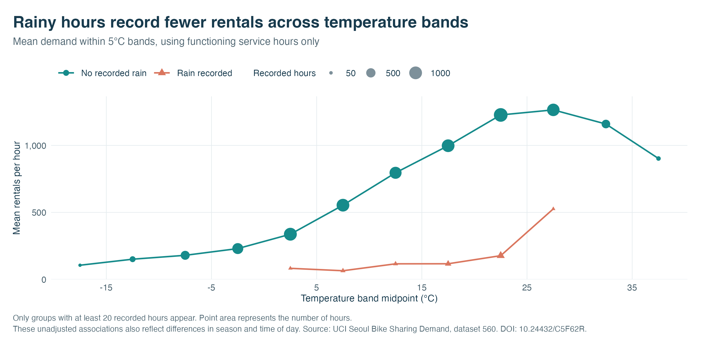

```{r setup, include=FALSE}
knitr::opts_chunk$set(echo = TRUE, message = FALSE, warning = FALSE,
                      fig.align = "center", out.width = "100%")
```

## Questions and scope

We investigate the recorded relationship between hourly bike rentals, calendar patterns and weather in Seoul. The descriptive analysis uses the complete observation year. Model selection uses only the designated validation period. Every model is fixed before test evaluation. The report presents the principal visual story and the predictive limitations. This working document preserves the checks and intermediate evidence needed to reproduce those conclusions.

Repository: <https://github.com/Hi-Light-Jerry/lab-04>.

The source is the official UCI Seoul Bike Sharing Demand CSV, retrieved on 23 October 2026, DOI [10.24432/C5F62R](https://doi.org/10.24432/C5F62R). The original data carry the CC BY 4.0 licence. The source bytes remain unchanged in `data/SeoulBikeData.csv`.

## Reproduce the investigation

Run the following from the project root in RStudio. The analysis function checks the input, creates features, fits the candidate models and exports tables, diagnostic figures and machine-readable results. Re-running the script executes the same fixed protocol. It does not expand the search based on test performance.

```{r reproduce-analysis, results='hide'}
source("scripts/analysis.R")
if (!exists("analysis_results", inherits = TRUE)) {
  analysis_results <- run_analysis()
}
res <- analysis_results
source("scripts/visualisations.R")
```

The analysis implementation appears below so the full cleaning and modelling procedure can be inspected alongside its outputs.

```{r analysis-source, results='asis', echo=FALSE}
cat("```r\n", paste(readLines("scripts/analysis.R", warn = FALSE), collapse = "\n"), "\n```\n", sep = "")
```

## Input audit

Dates use day/month/year, and timestamps use Seoul local time. A date and hour pair must identify at most one observation. Numeric parsing and range checks fail explicitly when input values require review. We retain all non-functioning observations for the overview and exclude them only from the active-service demand model.

```{r data-audit}
knitr::kable(res$audit, caption = "Data audit produced from the original source file")
```

```{r missingness}
readr::read_csv("tables/missingness.csv", show_col_types = FALSE) |>
  knitr::kable(caption = "Missing entries in every original field")
```

```{r variable-dictionary}
knitr::kable(res$variable_dictionary)
```

```{r input-checksum}
digest::digest(file = "data/SeoulBikeData.csv", algo = "sha256")
```

The expected SHA-256 checksum is `373339b71a8935d69e9af0abf26a70744632119862eeb3919efb389a7b749c60`.

## The principal visual evidence

```{r heatmap, echo=FALSE}
knitr::include_graphics("img/fig-01-demand-heatmap.png")
```

The heatmap keeps every date and hour visible, including hours when the service was not functioning. Annual differences and repeated daily variation can be considered together. The colour transformation and closure treatment appear in the visualisation source below.

```{r profiles, echo=FALSE}
knitr::include_graphics("img/fig-02-hourly-profiles.png")
```

```{r weather, echo=FALSE}

```

```{r visualisation-source, results='asis', echo=FALSE}
cat("```r\n", paste(readLines("scripts/visualisations.R", warn = FALSE), collapse = "\n"), "\n```\n", sep = "")
```

## Descriptive summaries

These summaries use functioning hours across the full year. They describe observed associations and do not estimate causal effects. In particular, temperature, precipitation, time of day and season can vary together.

```{r monthly-summary}
knitr::kable(res$monthly_summary, digits = 1)
```

```{r rain-summary}
knitr::kable(res$weather_summary, digits = 1)
```

```{r hourly-summary}
knitr::kable(res$hourly_profile, digits = 1)
```

## A fixed chronological evaluation

The intended boundaries are training through 31 July 2018, validation from 1 August to 30 September, and test from 1 October to 30 November. Table dates show the first and last available functioning observations within each boundary, so a closure can make the last observed date earlier than the boundary.

```{r split-summary}
knitr::kable(res$split_summary)
```

The calendar baseline uses the training mean within each hour and weekday. The linear model uses hour and day type, weather measurements, quadratic temperature and two annual sine and cosine terms. Dew-point temperature is excluded because it overlaps strongly with other temperature and humidity information. The tree uses a fixed depth limit, minimum leaf size and a six-value pruning grid. No season factor is required, which avoids introducing an unseen categorical season at prediction time.

The weather predictors are observed in the response hour. Accordingly, the task is retrospective conditional prediction. A deployed advance forecast would need a separate protocol that uses only weather forecasts available when predictions are issued.

```{r tree-tuning}
knitr::kable(res$tree_tuning, digits = 3,
             caption = "Tree pruning comparison on validation data only")
```

```{r validation-results}
knitr::kable(res$validation_metrics, digits = 3)
```

```{r validation-plot, echo=FALSE}
print(res$plots$validation)
```

The model with the lowest validation RMSE is **`r res$selected_model`**. Its selection remains fixed when the test set is examined. The model is refitted on the combined training and validation periods, with its selected specification unchanged.

## Test performance and diagnostics

Every frozen candidate is evaluated on the same test observations. Reporting the alternatives makes a validation-to-test ranking reversal visible. It does not change the validation-selected headline model.

```{r test-results}
knitr::kable(res$test_metrics, digits = 3)
```

RMSE gives large errors extra weight, while MAE averages their absolute size. Mean error is prediction minus observation, so negative values indicate underprediction. Test R-squared compares squared error against a predictor equal to the test-sample mean and can be negative.

```{r test-week, echo=FALSE}
print(res$plots$test_week)
```

The seven-day display starts at the beginning of the fixed test period. It provides an illustration of errors rather than a replacement for the metrics covering all test observations.

```{r hourly-bias, echo=FALSE}
print(res$plots$test_errors)
```

A systematic pattern in mean error by hour can identify a model weakness. This is a diagnostic for future work. Adjusting the model after seeing it would require a fresh evaluation period.

## Limits and next investigations

Only one city and one annual cycle are represented. The chronological split therefore measures performance through a particular seasonal transition. Hourly observations may be serially dependent, and no conventional independent-error significance tests are used here. Rentals can be constrained by supply, so they are an incomplete measure of underlying customer demand. The active-service analysis also leaves closure prediction outside its scope.

Useful extensions include multiple years, validation over successive time windows, forecast weather inputs and station-level availability. These extensions require new data or a new evaluation protocol. They are not presented as completed work.

## Session information

```{r session-information}
sessionInfo()
```

## References

Seoul Bike Sharing Demand [Dataset]. (2020). UCI Machine Learning Repository. <https://doi.org/10.24432/C5F62R>. Retrieved 23 October 2026. [CC BY 4.0](https://creativecommons.org/licenses/by/4.0/).

University of Edinburgh. *Introduction to Data Science: Final Projects*. <https://uoe-ids.netlify.app/assessments/project/>. Structure adapted from <https://github.com/uoeIDS/project_template>.
