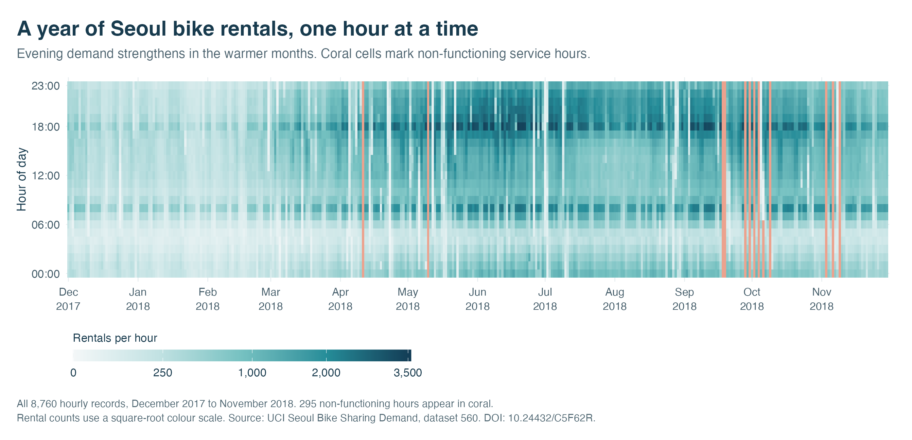
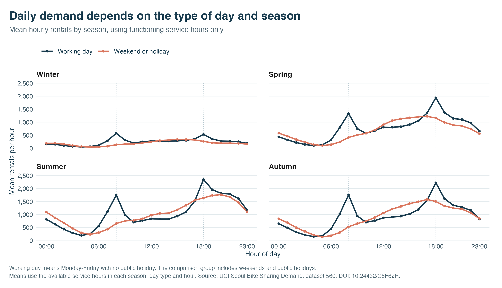

```{r setup, include=FALSE}
knitr::opts_chunk$set(echo = FALSE, message = FALSE, warning = FALSE,
                      fig.align = "center", out.width = "100%")
if (!exists("analysis_results", inherits = TRUE)) {
  source("scripts/analysis.R")
  analysis_results <- run_analysis()
}
res <- analysis_results
if (!file.exists("img/fig-01-demand-heatmap.png")) source("scripts/visualisations.R")
fmt <- function(x, digits = 0) formatC(x, format = "f", digits = digits, big.mark = ",")
selected_test <- res$test_metrics[res$test_metrics$model == res$selected_model, ]
baseline_test <- res$test_metrics[res$test_metrics$model == "Calendar baseline", ]
linear_test <- res$test_metrics[res$test_metrics$model == "Linear regression", ]
selected_validation <- res$validation_metrics[res$validation_metrics$model == res$selected_model, ]
jan <- res$monthly_summary[res$monthly_summary$month == as.Date("2018-01-01"), ]
jun <- res$monthly_summary[res$monthly_summary$month == as.Date("2018-06-01"), ]
working_8 <- res$hourly_profile[res$hourly_profile$day_type == "Working day" & res$hourly_profile$hour == 8, ]
working_18 <- res$hourly_profile[res$hourly_profile$day_type == "Working day" & res$hourly_profile$hour == 18, ]
other_8 <- res$hourly_profile[res$hourly_profile$day_type == "Weekend or holiday" & res$hourly_profile$hour == 8, ]
wet <- res$weather_summary[res$weather_summary$weather == "Rain recorded", ]
dry <- res$weather_summary[res$weather_summary$weather == "No rain recorded", ]
```

## Research Question

Bike sharing services need to anticipate when customers will rent bicycles. A daily average can conceal sharp changes across the morning, evening and seasons. Such differences matter when considering operating hours and the timing of bicycle redistribution. This project asks how hourly rentals in Seoul vary with the calendar and weather, and whether those variables support accurate predictions for later months.

We separate description from prediction. The descriptive question concerns the recorded year's demand patterns, including the contrast between working days and weekends or holidays. The predictive question concerns how well a model trained on earlier observations performs on a later period. Our objective is to produce an interpretable investigation with an honest assessment of predictive limitations. The data describe completed rentals across the system. They cannot reveal the number of people who wanted a bicycle but could not obtain one.

The reproducible R code, source data and supporting outputs are available in our [GitHub repository](https://github.com/Hi-Light-Jerry/lab-04).

## Data

We use the Seoul Bike Sharing Demand dataset from the UCI Machine Learning Repository, downloaded on 23 October 2026. It contains `r fmt(nrow(res$data))` hourly records covering `r format(min(res$data$date), "%d %B %Y")` to `r format(max(res$data$date), "%d %B %Y")`, with fourteen original columns. The response is the number of bicycles rented within each hour. Explanatory variables include hour, temperature, humidity, wind speed, visibility, solar radiation, precipitation, season, holiday status and whether the service was functioning. Temperature is measured in degrees Celsius, rainfall in millimetres and snowfall in centimetres.

The cleaning script reads the original character encoding, parses dates as day/month/year, converts measurement fields to numbers and creates timestamps in Seoul's local time zone. It checks numeric conversion, duplicate records, conflicting date and hour combinations, plausible ranges and categorical labels. The source file has no missing cells or exact duplicate rows. We retain its original bytes and record a SHA-256 checksum so that the input can be verified.

The functioning indicator requires particular care. There are `r fmt(res$summary$dataset$non_functioning_rows)` non-functioning hours, all with zero recorded rentals. Those zeros describe a service closure. We retain them in the overview figure, but exclude them when estimating demand during service operation. This leaves `r fmt(nrow(res$active))` observations for modelling. No operating hours require removal for missing values. We classify a working day as a Monday to Friday that is not marked as a holiday. All remaining days form the weekend or holiday group.

This choice defines the population addressed by the model: hours when the service operates. Including closure zeros would combine customer behaviour with an administrative availability decision. Conversely, excluding them means that our prediction error does not measure the quality of an all-hours staffing or revenue forecast. Both the retained overview and the modelling sample are therefore needed to explain the results.

## Findings

### One figure places the whole year in context

```{r demand-heatmap, fig.cap="Figure 1. Every recorded hour across the observation year. The colour scale represents hourly rental counts. Coral marks non-functioning hours, which remain separate from low demand."}

```

Figure 1 is the main visualisation. Aligning dates horizontally and local hours vertically allows the reader to see both annual changes and repeated daily patterns without selecting a few favourable days. The distinction between service closures and low counts also makes an important data decision visible. Stronger demand appears through much of the warmer part of the record, especially later in the day. Winter generally has lower counts. These patterns motivate calendar and weather predictors while preserving the substantial variation between individual dates.

The square-root colour transformation makes moderate and low counts visible while retaining the highest values. The legend still labels rental counts in their original units. Consequently, equal changes in colour should not be read as equal numerical increases. Monthly labels and repeated hour marks keep the dense display readable, while the separate coral treatment prevents a closure from resembling an unusually quiet operating day.

For scale, the mean during functioning hours rises from `r fmt(jan$mean_rentals, 1)` rentals in January to `r fmt(jun$mean_rentals, 1)` in June. This is a comparison between two observed months. A single annual cycle cannot establish a stable seasonal effect, distinguish weather from changes in the service, or demonstrate what would happen in another year.

### Daily profiles differ across day types

```{r hourly-profiles, fig.cap="Figure 2. Mean hourly rentals during service operation, showing how daily profiles differ across the recorded seasons. Each point summarises the available operating hours in its group."}

```

The supporting profile plot makes the daily structure easier to compare. Across the full active-service sample, working days average `r fmt(working_8$mean_rentals, 1)` rentals at 08:00 and `r fmt(working_18$mean_rentals, 1)` at 18:00. The weekend or holiday mean at 08:00 is `r fmt(other_8$mean_rentals, 1)`. The working-day profile is consistent with commuting activity, although the dataset records no individual journey purpose. Season and weather composition can also differ between the groups, so the comparison remains descriptive.

Rain is associated with substantially lower recorded use. The `r fmt(wet$n)` functioning hours with positive rainfall average `r fmt(wet$mean_rentals, 1)` rentals, compared with `r fmt(dry$mean_rentals, 1)` across `r fmt(dry$n)` hours with no recorded rainfall. This unadjusted contrast combines different hours, temperatures and dates. It therefore provides a useful summary and a modelling motivation, without identifying a causal effect of rain.

### Models face a later period

We divide the active-service observations chronologically. Training uses December 2017 to July 2018, validation uses August and September, and the test period covers October and November. The partitions contain `r fmt(nrow(res$train))`, `r fmt(nrow(res$validation))` and `r fmt(nrow(res$test))` hours respectively. Keeping later months separate avoids the optimistic evaluation that can arise when nearby hourly observations enter both training and test samples at random.

The calendar baseline predicts the earlier mean for each hour and weekday combination. Linear regression adds weather measurements, a quadratic temperature term, an interaction between hour and day type, and sine and cosine terms for position within the year. Rainfall and snowfall enter after a logarithmic transformation. A regression tree allows nonlinear splits and interactions without specifying their exact form. We compare six pruning settings using validation error, with a fixed maximum depth and minimum leaf size to limit complexity. Predictions from all models are bounded below by zero.

The baseline supplies a meaningful reference because a more elaborate model should justify the extra data it requires. Hour is categorical in the linear model, allowing a morning peak without imposing a straight line across the day. Its interaction with day type allows different daily profiles. Annual sine and cosine terms represent a continuous calendar cycle and avoid a categorical season that might be absent from the initial training sample. We exclude dew-point temperature to reduce overlapping weather information.

The selection criterion is root mean squared error (RMSE), measured in bicycles per hour. Squaring errors gives larger mistakes more weight. Mean absolute error (MAE) provides a complementary measure that gives each absolute error equal weight. The regression tree achieves the lowest validation RMSE, `r fmt(selected_validation$rmse, 1)`, so it remains our selected model. We freeze the specifications, refit using training and validation data, then evaluate the final test period. Test results do not determine a replacement winner.

```{r model-comparison}
res$test_metrics |>
  dplyr::transmute(
    Model = model,
    `Selected on validation` = ifelse(selected_on_validation, "Yes", "No"),
    `Test RMSE` = round(rmse, 1),
    `Test MAE` = round(mae, 1),
    `Mean prediction error` = round(mean_error, 1)
  ) |>
  knitr::kable(caption = "Table 1. Performance on the same held-out operating hours in October and November. Negative mean error indicates underprediction. All errors are in bicycles per hour.")
```

The selected tree's test RMSE is `r fmt(selected_test$rmse, 1)`, exceeding the baseline's `r fmt(baseline_test$rmse, 1)` by `r fmt(100 * (selected_test$rmse / baseline_test$rmse - 1), 1)`%. Its validation advantage fails to transfer to this later period. Linear regression has the lowest test RMSE, `r fmt(linear_test$rmse, 1)`, although its MAE exceeds the baseline's. The models therefore rank differently across periods and error measures. Reporting this reversal is essential to understanding their practical limitations.

Within each period, every model uses exactly the same evaluation rows, making the error comparison direct. Comparisons between validation and test require more care because the weather, demand distribution and number of functioning hours change. We have no specified financial cost for either overprediction or underprediction. RMSE supplies a transparent selection rule, while the reported MAE and signed error show why operational objectives could favour a different assessment.

### Interpretation and limitations

The visual evidence supports using time of day and calendar context when studying system-wide rentals. The prediction exercise gives a more cautious conclusion: additional weather information and a flexible algorithm do not guarantee improvement over a simple calendar rule in a later season. All three models underpredict on average during the test period. We retain that weakness rather than adjusting the models after inspecting their test errors.

These predictions condition on weather measured in the same hour. An operational advance forecast would require weather forecasts available at the decision time and a new evaluation using those forecasts. Hourly observations may also be dependent. We avoid presenting conventional regression significance tests or confidence intervals that would assume independent errors. The chronological split tests one particular seasonal transition, and validation itself may favour patterns specific to late summer.

The aggregate data contain no individual rider attributes, which limits personal information exposure. However, a system-wide average can conceal differences between neighbourhoods and users. Decisions based only on high rental counts could favour already busy locations while overlooking areas with unmet demand or limited bicycle supply. Our results therefore support exploratory understanding of recorded use. They do not establish a fair allocation policy or provide station-specific operational recommendations.

Further work should use several years, repeat validation across successive time windows and assess performance during high-demand hours. Station-level availability and unmet-demand information would help connect the analysis to redistribution decisions. Until those data and checks are available, the findings describe associations within this historical system and the limitations of the specified conditional prediction models.

## References

Seoul Bike Sharing Demand [Dataset]. (2020). UCI Machine Learning Repository. <https://doi.org/10.24432/C5F62R>. Retrieved 23 October 2026. Licensed under [Creative Commons Attribution 4.0 International](https://creativecommons.org/licenses/by/4.0/).

University of Edinburgh. *Introduction to Data Science: Final Projects*. <https://uoe-ids.netlify.app/assessments/project/>. Project structure adapted from the [course project template](https://github.com/uoeIDS/project_template).
